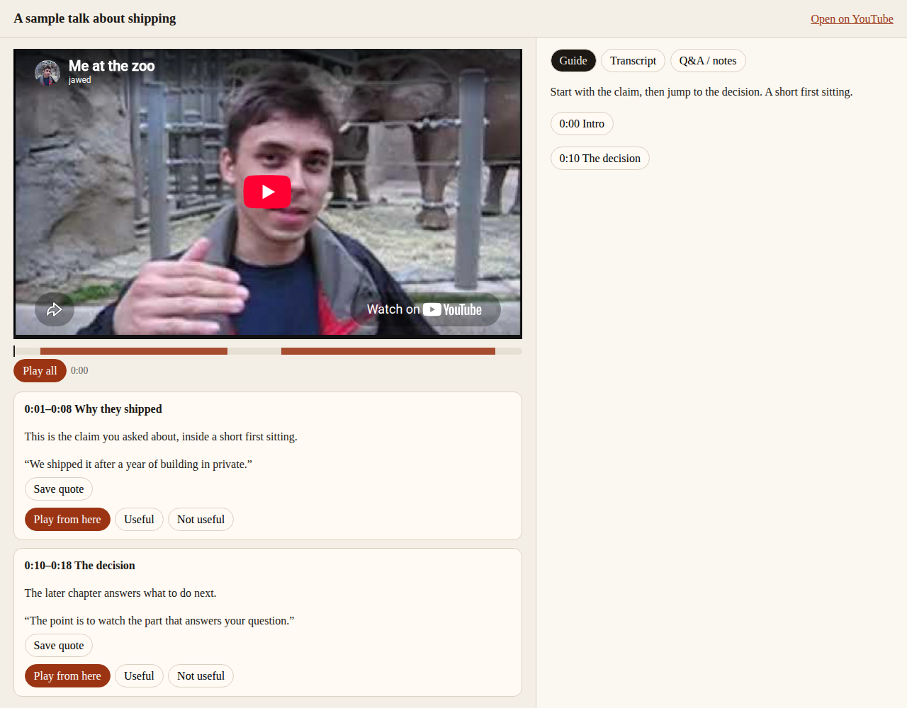

# Personal Video Guide

**别让 AI 总结视频了，让它带你看。**

A local toolkit that lets a host agent (Claude, ChatGPT, WorkBuddy, …) act as your
personal video guide: it finds the new episodes from the channels you care about,
tells you *why* each one is worth your time, and hands you a link that starts
playing at the exact second. The agent does the thinking; this toolkit does the
deterministic parts — discovery, captions, search, timestamps, links — so the
agent never invents a quote or a time.

The method comes from 刘小排's post《别让AI总结视频了，让它带你看》(2026-10-27).
This repository is an open implementation of it.

## The four steps

| Step | What you do | What the guide does |
| --- | --- | --- |
| **1. Align** | Tell the agent what you care about and which channels to watch. | Stores your profile and sources; resolves channel links to feeds. The host sets up the daily schedule — after you confirm. |
| **2. Daily digest** | Read the morning card; pick what to watch yourself. | Checks every feed, finds what is new, locates the best segments, and records what it recommended so it never pushes the same video twice. |
| **3. Jump in** | While watching, ask about a half-remembered point. | Searches the captions for the actual words and returns a link with `t=` set a few seconds before them. |
| **4. What's next** | Ask what else in this episode is worth it, given what you are thinking about. | Serves the transcript outline and windows so the host can recommend from your profile and the conversation. |

The guide never summarizes a video for you and never replaces watching. If it
cannot get the original words, it says so instead of making them up.

## How it fits together

```
┌──────────────┐   calls tools    ┌───────────────────────┐   HTTPS GET only
│  Host agent  │ ───────────────▶ │  video_guide          │ ────────────────▶ YouTube feeds
│  (model,     │ ◀─────────────── │  CLI + stdio MCP      │                   & caption tracks
│  schedule,   │   facts, links   │  no model calls       │
│  memory)     │                  │  local state only     │
└──────────────┘                  └───────────────────────┘
```

- **Skill** (`skills/personal-video-guide/`) — a short `SKILL.md` that teaches
  the host the method: alignment questions, the digest card format, the evidence
  rule, and what to do when something is missing.
- **Toolkit** (`src/video_guide/`) — the deterministic half. Source
  normalization, RSS discovery with de-duplication, caption fetch and cache,
  outline / read / lexical search over transcripts, link generation, and an
  atomic local state store (`~/.video-guide/`).
- **Host** — your agent. It judges relevance, writes the "why it's worth it",
  rewrites your fuzzy question into the video's language, runs the schedule,
  and delivers the card.

Full design: [docs/design.md](docs/design.md). Build plan:
[docs/plan.md](docs/plan.md). What each host can actually do today:
[docs/host-compatibility.md](docs/host-compatibility.md).

## Status

The watching loop is in place and tested offline: give the CLI a YouTube URL,
it fetches captions, searches them, and returns a playback link. The same
tools are available as a local stdio MCP server and a Codex plugin. See
[Use with Codex](#use-with-codex). The daily digest (`digest.record`,
`sources.json`) is still open. See [docs/plan.md](docs/plan.md) and
[docs/host-compatibility.md](docs/host-compatibility.md).

| Area | State |
| --- | --- |
| Profile, seen / feedback logs (atomic writes, schema-versioned) | done |
| `sources.json` persistence | not built yet. `GuideStore` does not write a source list |
| Channel link → feed; `@handle` resolution; RSS discovery with 48 h overlap and per-source isolation | done. `@handle` resolution still takes the first `channelId` on the page |
| Caption fetch and cache (manual, then automatic with `en-orig` preferred, then a podcast transcript URL) | done. YouTube goes through a yt-dlp you install; cookies stay off unless the profile names a browser |
| Transcript outline, read, lexical search, `link.at` | done. Outline uses chapters stored from yt-dlp metadata when you omit `--description` |
| CLI (`video-guide`) | done for `transcript get` / `read` / `outline`, `search`, `link`, `profile`, and `mcp` |
| stdio MCP server | done. Install the `mcp` extra. Codex launches it locally |
| Skill and Codex plugin | done. Daily digest recording is still not wired |
| Local guide page | done. `open_guide` serves it on 127.0.0.1 and embeds YouTube's player |

## Watching loop

Install the package, and install `yt-dlp` yourself. This package does not
install, bundle, or pin it. Current yt-dlp needs a JavaScript runtime to solve
YouTube's player script; install [deno](https://docs.deno.com/) and
`python -m pip install -U "yt-dlp[default]"` (that extra pulls `yt-dlp-ejs`).
If `yt-dlp` is installed in the same virtualenv as this package, it is found
there even when it is not on `PATH`. That includes a uv venv, where
`bin/python` is a symlink to a managed CPython: the lookup uses the symlink's
own directory before following it.

```bash
python -m pip install -e .
video-guide transcript get 'https://www.youtube.com/watch?v=VIDEO_ID'
video-guide search 'https://www.youtube.com/watch?v=VIDEO_ID' 'a phrase you remember'
video-guide link 'https://www.youtube.com/watch?v=VIDEO_ID' 754
```

`transcript get` prints the caption language, the kind (`manual`, `auto`, or
`podcast`), the duration, and how many cues were stored. The cue text stays in
the local cache (`~/.video-guide/cache/captions/`, or `$VIDSNAP_GUIDE_HOME`).
`search` prints each matching cue, the cue before it, the cue after it, and a
`https://www.youtube.com/watch?v=…&t=…s` URL. `link` builds that URL from the
second you pass.

Playback starts 5 seconds before that moment, floored to a whole second, and
never before zero. `timestamp` is the clock for the moment you asked about.
`playback_timestamp` is the clock for the `t=` value. Both come from the tool.

YouTube often refuses caption requests that carry no cookies. Cookies stay off
until you opt in. The package never opens a cookie file and never puts the
path or the contents in caption errors. yt-dlp reads them itself, either from
a browser or from a Netscape `cookies.txt` you already have (useful on a
machine with no local browser):

```bash
video-guide profile set --cookies-from-browser chrome
video-guide profile set --cookies /path/to/cookies.txt
video-guide profile set --clear-cookies
video-guide profile set --clear-cookies-file
video-guide profile set --ytdlp-path /path/to/yt-dlp
```

Allowed browser names are `chrome`, `firefox`, `safari`, `edge`, and `brave`.
When both a browser and a cookies file are set, the file is what yt-dlp
receives. `profile show` prints the path you saved; caption commands do not.

Caption fetch reads the track list, then downloads one language. Many
`*-orig` codes are auto-dubs, and yt-dlp's language field can follow the
signed-in account, so neither is treated as the spoken language. A Latin-script
title selects manual `en` or `en-orig` when that track exists. Set a caption
language when you want a specific track instead; that choice wins whenever the
video has it. If the downloaded words are in a different script from the title,
one alternate track is tried. The saved `kind` and `language` are the file
that was actually written.

```bash
video-guide profile set --caption-language zh-Hans
video-guide profile set --clear-caption-language
```

A missing yt-dlp returns `ytdlp_missing`. The YouTube sign-in wall returns
`bot_check`. HTTP 429 on a subtitle download is retried twice (after 5s, then
15s) and then returned as `rate_limited`. With cookies still off, either error
includes the hint `no_cookies`. Both messages also mention `curl_cffi`: yt-dlp
uses it to impersonate a browser, and warns when it is missing. Install it
beside yt-dlp, or, when yt-dlp shares this environment,
`python -m pip install 'personal-video-guide[impersonate]'`.
`--cookies-from-browser` can fail on macOS when the process cannot read the
browser cookie database (often missing Full Disk Access). That is
`cookies_unreadable`, with a hint to export a Netscape `cookies.txt` instead.
The error text does not include the database path. A video with no caption
track returns `no_captions`. The tool does not invent a quote or a timestamp
when that happens.

On a datacenter or proxy IP, a cookies file mattered more than a PO token
provider in the 2026-11-05 check (see the pull request notes). This package
does not configure a PO token provider.

YouTube channel feeds that answer 404 or 5xx are retried up to three times,
with a short backoff, before that source is reported as failed.

`transcript outline` prints chapters. Pass `--description` when you have
chapter lines such as `00:00 Intro`. If you omit it, the command uses the
description and the `chapters` list saved from the yt-dlp metadata dump at
fetch time. With neither, it slices the captions into 5-minute windows.
`transcript read START END` prints the cues in that range, up to 8,000
characters.

Podcast RSS items keep a Podcasting 2.0 `podcast:transcript` URL when the feed
publishes one. Loading that file is `load_podcast_transcript` in
`video_guide.captions`, through the same allow-listed HTTPS GET as other
feeds. The CLI commands above take a YouTube URL.

## Use with Codex

Codex starts the tools on your machine. There is no hosted server and no API key.

1. Install the package and the MCP extra, and install `yt-dlp` yourself. Current yt-dlp needs a JavaScript runtime. Install [deno](https://docs.deno.com/), then `python -m pip install -U "yt-dlp[default]"` so `yt-dlp-ejs` is present. Put `yt-dlp` on `PATH`, or install it into the same environment as `video-guide` (a uv venv is fine).

```bash
python -m pip install 'personal-video-guide[mcp]'
video-guide mcp
```

`video-guide mcp` speaks MCP on stdin and stdout. If the extra is missing, the command prints `mcp_missing` and the install line above, and the other subcommands still work.

2. Export a Netscape `cookies.txt` from a browser that is signed in to YouTube. Point the profile at that file. The package does not open it.

```bash
video-guide profile set --cookies /path/to/cookies.txt
video-guide profile set --caption-language en
```

Use `--caption-language` when you want a specific track. A Latin-script title otherwise prefers manual `en` or `en-orig`. Cookies mattered more than a PO token on the 2026-11-05 check. This package does not configure a PO token provider.

3. Go slowly. A subtitle HTTP 429 is retried twice (after 5 seconds, then 15) and then returned as `rate_limited`. One watch-along is one metadata read plus one caption download. Do not fan out across many videos in parallel.

4. Add the plugin marketplace from a checkout of this repo, then install **Personal Video Guide**:

```bash
codex plugin marketplace add PCcoding666/personal-video-guide
```

The repo root is the plugin. `.codex-plugin/plugin.json` points at `./skills/` and `./.mcp.json`. `.mcp.json` runs `video-guide mcp` over stdio. `plugin.json` and `mcp.json` are the same package in the current Agent Plugins schema. The marketplace entry is `.agents/plugins/marketplace.json` with `source.path` `./`.

If marketplace install is unavailable, add the server by hand in `~/.codex/config.toml`:

```toml
[mcp_servers.video-guide]
command = "video-guide"
args = ["mcp"]
```

5. Start a watch-along in Codex: paste a YouTube URL and say what you want from it and how much time you have. Codex should outline the video, pick a few segments, and open a local page. The page is served on `127.0.0.1` because a YouTube embed does not run from `file://`. Left side: the player, the original link, and segment cards (click to seek, **Play all** for the sequence). Right side: Guide, Transcript, and Q&A / notes. When a segment ends, the page says `next suggested: jump to mm:ss` and offers Jump or Skip. Useful / Not useful is written to `feedback.jsonl` in the state directory and also kept in the browser's `localStorage`. Saved quotes are notes in `localStorage` only.

Ask Codex for a link only after it has called the link tool. If captions fail, there is no quote and no timestamp to invent.



The picture is the local page. The player is YouTube's own embed, loaded over HTTP from `127.0.0.1`. The cards are sample captions, not that video's transcript.

## Known gaps

- `sources.json` is not written. A source list does not survive a restart.
- Feed responses larger than 5 MB are refused (`DEFAULT_MAX_BYTES` in `fetch.py`), which rejects some large podcast feeds.
- `@handle` resolution uses the first `channelId` on the channel page, so a page that mentions another channel first can resolve to the wrong feed.
- `digest.record` is not wired, so a daily digest cannot yet mark videos as already recommended. ASR is out of scope.

## Development

Python 3.10+. No network, no model calls, no real media in tests.

    python -m pip install -e '.[dev]'
    python -m pytest -q
    python -m mypy src
    ruff check . && ruff format --check src tests

## Boundaries

Deliberately out of scope: accounts, SaaS, media (video/audio) downloads,
anti-bot bypasses, bundled cookies, vector search, schedulers or notification
senders inside the toolkit. Scheduling and delivery belong to the host. The
watch-along page embeds YouTube's own iframe from a local `127.0.0.1` server.
It is not a bundled player and it does not download the video. Network access
is an allow-list of HTTPS GET requests (feed and caption endpoints, plus a
one-time channel-page fetch to resolve a handle). YouTube captions are the
one exception: they are fetched by running a `yt-dlp` you installed yourself,
with subtitle-only arguments and never a media download. Browser cookies are
off by default; if you turn them on in your profile, `yt-dlp` reads them from
your own browser or from a Netscape `cookies.txt` path, and the package never
stores or logs them.

Originally prototyped inside [VidSnap](https://github.com/PCcoding666/Vidsnap)
on the `feat/personal-video-guide` branch and split out on 2026-11-01.

## License

MIT
