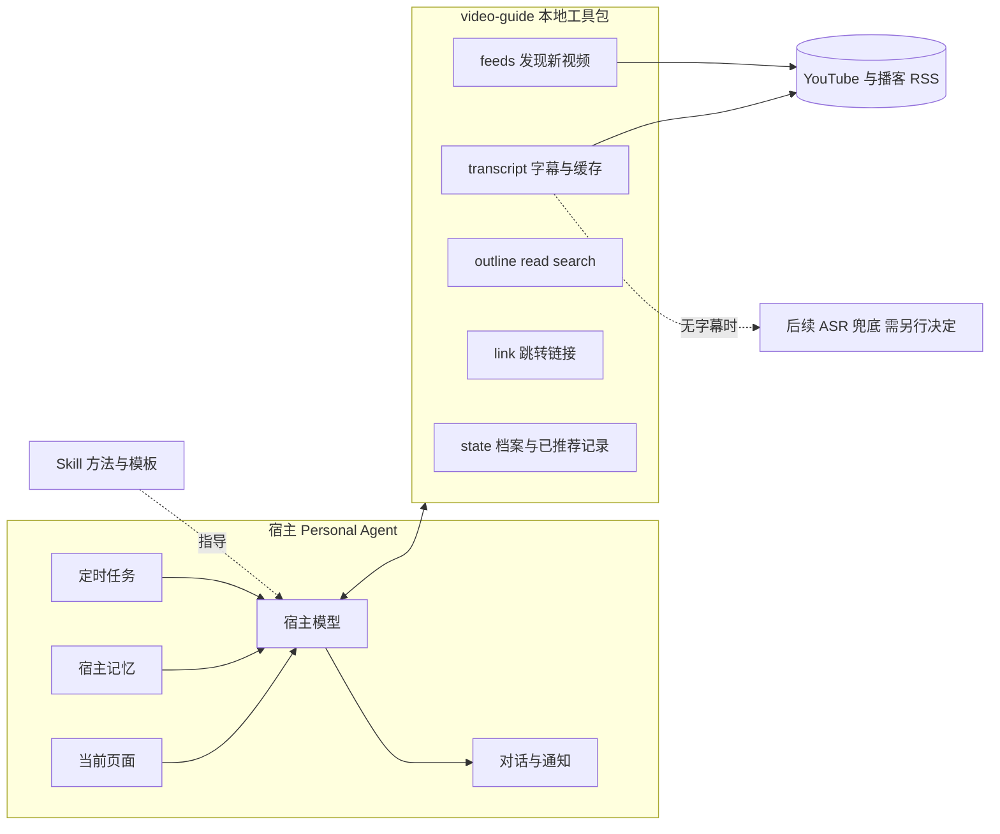

# VidSnap 私人视频导游设计 v2

> 注（2026-11-01）：本设计原写于 VidSnap 仓库的 `feat/personal-video-guide` 分支，第 9 节"留在本仓库"的结论已改变：导游工具包现已拆分为独立仓库 personal-video-guide，包名 `video_guide`。文中提到的 Vidsnap 路径请按本仓库布局（`src/video_guide/`、`tests/`、`docs/`）对应阅读。

日期：2026-10-31（v2 修订）。分支：`feat/personal-video-guide`。

状态：设计草案。保留 v1（`e912aae`）的产品方向，按评审意见重写了架构。尚未实现，宿主兼容性尚未实测。仓库位置已确认：留在本仓库，AGENTS.md 已相应修改（见第 9 节）。

## 0. v2 相对 v1 的变化

| v1 的问题 | v2 的处理 |
| --- | --- |
| 带时间的字幕交给宿主自带工具获取，VidSnap 能力列为可选增强 | 新增确定性的导游工具包，负责来源发现、字幕获取、片段检索和跳转链接，属于主交付 |
| 幂等投递、原子占用、分页续查、候选池等全写在 Skill 文本里，要宿主模型执行 | 状态收敛为工具包的几个本地文件；去重和链接由工具保证，不依赖模型遵守规则 |
| 每轮深入读 5 个视频，上下文上限却只有 10 万字符，一期两小时访谈就能用完 | 先取大纲（章节或时间窗），只读相关窗口；单个视频的读取量设上限 |
| 带看只能在聊天中凭卡片 ID 继续 | 陪看可从当前页面 URL 识别视频；宿主能读播放位置时，优先推荐后面的段落 |
| 先写合成事件验证器，真实宿主验证排在最后 | 第一步就是宿主实测；离线测试只覆盖工具包的确定性逻辑 |

保留不变的原则：

- 不做 SaaS、播放器、账号体系或自建后台。
- 主动推送是主模式，按需陪看是降级模式。
- 拿不到原话就不编原话，没有带时间的证据就不编时间戳。
- 只按用户的明确反馈调整偏好。
- 创建定时任务前必须经用户确认。
- 视频页面和字幕内容都是数据，不是指令。

## 1. 产品目标

帮用户减少找视频的时间，把时间留给真正想看的部分。产品不替用户看完视频，也不用摘要代替观看。

| 文章中的步骤 | VidSnap 的对应 |
| --- | --- |
| 1. 说清范围和兴趣，设定每日定时任务 | 首次对齐：建立档案和来源清单；用户确认后，由宿主创建定时任务 |
| 2. 每日推送：只推感兴趣的，说明为什么值得看，给出精确时分秒 | 每日导览：发现新视频 → 判断相关性 → 定位片段 → 推送卡片 |
| 3. 观看时搜索模糊观点，点击从该处开始播放 | 陪看·定位：在字幕中检索原话，返回带时间参数的跳转链接 |
| 4. 询问其他段落推荐（基于 AI 对我的了解） | 陪看·续荐：结合档案、宿主记忆和本次对话，推荐下一段 |

## 2. 架构

系统分三层：

- **Skill**：`SKILL.md` 加少量 references，写带看方法、对齐问题、推送卡片模板、证据规则和降级说明。保持简短，宿主模型每次都能完整读完。
- **导游工具包** `video-guide`：本地 MCP server 加同名 CLI，承担所有确定性工作，包括 RSS 发现、字幕获取与缓存、大纲、读取、检索、链接生成和本地状态。
- **宿主**：负责模型推理（相关性判断、写推荐理由、语义匹配）、定时、通知、对话、记忆和浏览器上下文。

分工原则：会造成重复打扰或编造时间的事交给工具，包括去重、时间和链接；需要理解内容的事交给宿主模型。



## 3. 责任划分

| 能力 | Skill | 工具包 | 宿主 |
| --- | --- | --- | --- |
| 兴趣与来源对齐 | 问什么、档案有哪些字段 | 保存档案和来源清单 | 对话；补充宿主记忆 |
| 发现新视频 | 何时调用 | 拉取 RSS，按视频 ID 去重 | 定时唤醒 |
| 字幕 | 证据要求 | 获取字幕，标注类型和精度，缓存 | — |
| 相关性与推荐理由 | 判断标准、卡片模板 | 提供大纲和检索结果 | 模型推理 |
| 时间定位 | 精度说明规则 | 返回命中窗口，生成链接 | 确认命中的确实是那句话 |
| 推送 | 什么时候值得推，什么时候保持安静 | 记录已推荐的视频 | 定时运行、通知渠道 |
| 反馈 | 只认明确反馈 | 写入记录 | 对话 |

## 4. 工具包接口

MCP 工具和 CLI 子命令一一对应。CLI 供不支持 MCP、但能执行命令的宿主使用，也方便调试。

| 工具 | 输入 → 输出 | 说明 |
| --- | --- | --- |
| `sources.add` / `list` / `remove` | 频道或播客的链接 → 规范化来源（类型、ID、RSS 地址） | `/channel/UC…` 和 RSS 链接离线规范化；`@handle` 一次性抓频道页解析 channel_id（白名单内）；都解析不出就请用户提供链接，不猜 |
| `feeds.check` | 来源 ID 列表（缺省为全部）→ 新视频列表，以及每个来源的成功或失败 | YouTube 用频道 RSS（`/feeds/videos.xml?channel_id=`），播客用自身 RSS；只返回未推荐过、且晚于上次成功检查的条目（窗口重叠 48 小时） |
| `transcript.get` | 视频 ID 或 URL → 状态、语言、字幕类型、时长、句数 | 字幕类型为人工、自动、ASR 或无；结果缓存到本地；不返回全文 |
| `transcript.outline` | 视频 ID → 章节列表，或固定时间窗（默认 5 分钟）及每窗开头几句 | 章节从简介里的时间戳解析；让宿主先看目录再决定读哪段 |
| `transcript.read` | 视频 ID + 起止秒 → 该区间带句级时间的字幕 | 单次最多约 8,000 字符 |
| `transcript.search` | 视频 ID（缺省为最近推荐过的视频）+ 若干查询短语 → 按得分排序的命中窗口（起止时间、原文、链接） | 词法检索；跨语言时由宿主模型把问题改写成视频语言的多种说法 |
| `link.at` | 视频 ID + 秒数 → 跳转链接 | 卡片里只能出现由工具生成的链接 |
| `digest.record` / `digest.list` | 本次推荐的视频与片段 → 成功；或查询最近的推荐 | 记录后，`feeds.check` 不再返回这些视频；用户问“昨天推了什么”时可查 |
| `feedback.add` | 视频 ID + `interested` / `not_interested` / `watched` / `correct` + 可选说明 → 成功 | 只记录明确反馈 |
| `profile.get` / `set` | — | 长期兴趣、当前问题（带到期日）、推送时间与时区、每次最多几条、观看预算、无新内容时是否告知；字幕设置（`yt-dlp` 路径、`cookies_from_browser`，默认不开启） |

检索选型：第一版使用词法检索，由宿主模型改写查询，不引入向量模型，避免新增模型调用和 Key。实测跨语言召回不足时，再评估嵌入方案。

本地状态目录默认为 `~/.video-guide/`（可配置），包含 `profile.json`、`sources.json`、`seen.jsonl`、`feedback.jsonl` 和可随时清空的 `cache/`。所有文件都是可读、可手工编辑的文本，写入时先写临时文件再原子替换。

第一版假设同一时刻只有一个宿主任务在运行。两次运行若意外重叠，最坏结果是重复推送一条，这个代价可以接受，因此不设计锁或投递回执。

## 5. 字幕来源与精度

按以下顺序获取：

1. 平台人工字幕。
2. 平台自动字幕。
3. 播客 RSS 自带的转录文件（Podcasting 2.0 的 `podcast:transcript`）。
4. ASR 兜底：不在第一版。它需要下载音频，而 AGENTS.md 禁止导游工具包下载媒体，启用前需要单独决定。
5. 以上都没有：标记为无字幕。这种视频只能凭标题和简介作为“可能感兴趣”提示，不给原话和时间。

每个结果都附带精度标注，卡片据此措辞：

- 人工或自动字幕：句级时间，链接可精确到秒。自动字幕可能有识别错误，引用时需注明。
- ASR（后续）：精度取决于 ASR 是否返回句级时间。现有 VidSnap ASR（`qwen-audio-3.1-asr-flash`）每个请求只返回整段文本，切片长度为 240 秒（见 `src/vidsnap/video/audio.py` 的 `ASR_SEGMENT_SECONDS`），所以只能定位到约 4 分钟的窗口。要精确到句，需要换用能返回句级时间戳的 ASR 模式，留待实测后决定。
- 跳转链接一律从片段开头前 5 秒开始播放，保留一点上下文。

YouTube 的风险：字幕接口和视频下载都可能被反爬拦截。2026-11-01 实测（见[兼容性记录](host-compatibility.md)）：从本机代理出口发出的不带 cookie 的字幕请求，10 次全部被拒；使用用户已登录浏览器的 cookie 后，`yt-dlp` 能取到全片自动字幕。自动字幕要选 `en-orig` 原始轨，`en` 轨是机器翻译。

YouTube 字幕的获取方式已定为方案 A（2026-11-01 用户决定）：调用用户自己安装的 `yt-dlp`，只取字幕。

- 工具包不安装、不打包、不锁定 `yt-dlp` 版本。查找顺序是 profile 路径、`PATH`、当前 Python 解释器同目录；都找不到时返回 `ytdlp_missing`，并提示用户自行安装。
- 只用固定的参数白名单：`-J`（只读元数据，不下载 timedtext）、`--skip-download`、`--ignore-no-formats-error`、`--write-subs`、`--write-auto-subs`、`--sub-langs`（一次一个语言码）、`--sub-format json3/vtt`、`-o` 指向临时目录、`--no-playlist`。不使用 `--sub-langs all`，也不把按字母排在最前的 `*-orig` 当成原语言（那些多半是自动配音）。profile 的字幕语言优先；否则用标题文字的书写系统选择（拉丁字母标题优先 `en` / `en-orig`）。下载文本的书写系统若和标题不符，再换一条。字幕下载遇到 HTTP 429 时退避重试两次，仍失败则返回 `rate_limited`。
- 查找 `yt-dlp` 的顺序：profile 路径、`PATH`、当前 Python 解释器同目录（同一个 venv）。浏览器 cookie 数据库打不开时返回 `cookies_unreadable`，提示改用 Netscape `cookies.txt`，错误文本不含路径。
- cookie 默认关闭。用户可以在 profile 里填写 `cookies_from_browser`（例如 `chrome`），此时追加 `--cookies-from-browser <browser>`；也可以填写 Netscape `cookies.txt` 的路径 `cookies_file`，此时追加 `--cookies <path>`。两者都设置时只传 `--cookies`。工具包从不打开该文件，不把路径写进字幕错误或日志，也不读取、复制或保存 cookie 内容。
- 每次调用有超时；输出写进临时目录，解析完即删除。错误按原因归类为 `bot_check`（YouTube 要求登录的那句）、`rate_limited`（字幕下载 HTTP 429）、`cookies_unreadable`（浏览器 cookie 数据库打不开）、`no_cookies`（前两者在未配置 cookie 时的提示）、`no_captions`、`ytdlp_missing`、`timeout`。`bot_check` 和 `rate_limited` 的说明里会提到 yt-dlp 的可选依赖 `curl_cffi`（本包的 `impersonate` extra，装到与 yt-dlp 相同的环境）。不把 `yt-dlp` 的原始输出写进日志或返回值。
- 播客的 `podcast:transcript` 仍走工具包自己的白名单 HTTPS GET。

其他约束：

- 第一版只取字幕，不下载视频。
- 取不到字幕就如实报告，工具包不内置任何绕过手段。
- cookie 等凭据只能由用户在本机自行配置，不进入仓库或日志。
- 将来若启用 ASR 兜底，先面向播客：播客 RSS 直接提供音频文件，不涉及反爬。

## 6. 每日导览（主动服务）

用户确认后，宿主创建定时任务，内容是一句固定指令（例如“运行 VidSnap 每日导览”）。宿主模型读取 Skill 后按以下步骤执行：

1. 调用 `profile.get`。当前问题已过期时，在推送末尾提醒用户更新，不擅自修改。
2. 调用 `feeds.check` 获取新视频。没有新视频时，按用户设置保持安静，或发一句“今天没有新内容”。
3. 根据标题、简介、长期兴趣和当前问题粗筛，最多保留 5 个候选（可配置）。
4. 对每个候选依次调用 `transcript.get` 和 `transcript.outline`，挑 1–3 个相关窗口用 `transcript.read` 读取，必要时用 `transcript.search` 补充。每个视频最多读约 3 万字符。
5. 拿到字幕证据的候选才能做成卡片。只有简介的候选，列入末尾一行“可能感兴趣，但没拿到字幕”。
6. 组装推送，最多 3 张卡片（可配置）。
7. 调用 `digest.record`，然后输出推送。

推送本身就是定时任务的输出，所以组装完成后立即记录。如果宿主通知没送达，用户可以问“最近推了什么”，由 `digest.list` 找回。

卡片模板：

```text
【视频标题】频道 · 时长 · 发布日期
为什么值得你看：<与你当前问题或兴趣的关系，一两句>
最值得看的部分：
  ① 12:34–18:10  <这段讲什么>  ▶ <链接>
     原话："<不超过两句原文>"
  ② ……
建议观看：约 9 分钟（字幕：自动字幕，时间精确到句）
```

失败处理：

- 某个来源失败只影响该来源；推送末尾用一行说明“有 2 个来源这次没查到”。
- 同一来源连续 3 天失败，提示用户检查来源链接。
- 不做投递回执和自动重试。

## 7. 陪看（按需）

先确定是哪个视频，来源有三种：推送卡片（“带我看第一个”）、用户粘贴的链接、宿主能读到的当前浏览器页面 URL。

- **定位模糊观点**，例如“他在哪说先做了一年才发布”：
  1. 宿主把问题改写成视频语言的 3–5 种说法，调用 `transcript.search`。
  2. 读命中窗口，确认确实是那个观点。
  3. 返回原话、前后各一句上下文和跳转链接。
  4. 多处命中时逐条列出差别；没有命中时，说明“在已获取的字幕里没找到”，并给出字幕覆盖范围。
- **续荐**，例如“还有哪段值得看”：结合档案、宿主记忆和用户在本次对话里问过的内容，用 `outline` 和 `read` 选出下一段。能读到当前播放位置时，优先推荐之后的段落。
- **时间预算**，例如“我只有 10 分钟”：重新选段，合计时长不超过预算，不靠倍速凑时间。
- **反馈**：用户说“这个不错”“这类别再推了”“看完了”时，调用 `feedback.add`。修改长期兴趣前，先复述给用户确认。

## 8. 首次对齐

通过对话收集以下信息：

- 长期兴趣。
- 最近在想的问题；默认两周后提醒更新。
- 来源清单：以用户给的栏目为准。Skill 可以建议补充，但须经用户确认。
- 推送时间与时区、每次最多几条、无新内容时是否告知。
- 每天愿意花多少时间看。

逐个来源调用 `sources.add` 解析成 RSS，解析不出的列给用户。

调用 `profile.set` 保存后，再请用户确认创建定时任务。宿主返回任务确实存在的证据（任务名或 ID）后，才告诉用户“已开启”。宿主不支持定时任务时，说明只能按需使用。

文章作者的栏目清单可以作为示例展示，但不会默认写入档案。

## 9. 交付形态与仓库位置

工具包和 Skill 都留在本仓库，在 `feat/personal-video-guide` 分支开发。AGENTS.md 已加入相应条款：

- **工具包**：`src/video_guide/`，随 `vidsnap-harness` 包发布，提供 `video-guide` 命令（CLI）和 stdio MCP server。MCP 依赖放在可选 extra `guide` 中，不影响现有 Harness 的安装。
- **Skill**：`skills/personal-video-guide/SKILL.md`，可单独复制到宿主的技能目录。
- **边界**（以 AGENTS.md 为准）：
  - 工具包不依赖核心 runtime 和 providers，也不调用模型。
  - 只对白名单 HTTPS 地址发 GET 请求：YouTube 的 feed 和字幕端点、为解析用户提供的频道 @handle 一次性抓取其频道页以取得 channel_id，以及用户明确添加的 feed 地址。不下载媒体，不内置反爬绕过。
  - 唯一例外：YouTube 字幕通过调用用户自己安装的 `yt-dlp` 获取，只用白名单内的字幕参数，cookie 只在用户开启时使用（见第 5 节）。
  - 不下载任何媒体，不内置反爬绕过手段，不做调度和通知。
  - 本地状态目录在仓库之外，路径由用户配置；它和 CLI run index 是仅有的两种跨次记录。
- **ASR 兜底**：需要下载音频，不在第一版范围内，启用前需另行决定。
- **安装**：不需要新账号，也不需要 API Key。安装命令在发布时确定，目标是一条命令完成（例如 `uvx` 或 `pipx`）。宿主自身的模型额度照常消耗。

## 10. 降级

| 条件 | 能提供的体验 |
| --- | --- |
| 宿主既不能接 MCP，也不能执行命令 | 只有 Skill：用户粘贴字幕或文字稿后按需定位；不承诺主动推送 |
| 能用工具，但不支持定时 | 按需导览：用户说“看看今天有什么新的”，手动触发同一流程 |
| 能定时，但通知只在宿主内部 | 在宿主里查看推送；Skill 不另找通知渠道 |
| 读不到浏览器页面 | 陪看时由用户说出视频名或粘贴链接 |
| 取不到字幕 | 只给“可能感兴趣”提示，不给原话和时间 |

## 11. 第一步：宿主实测（先于任何开发；WorkBuddy 部分已于 2026-11-01 完成，结果见兼容性记录）

在 WorkBuddy 上，选 2–3 个真实栏目（例如 Lenny's Podcast、Dwarkesh Podcast 和一个 YC 频道），回答以下问题：

1. 不装任何工具时，宿主能否拿到一期 YouTube 访谈带时间的字幕？能否生成可用的带时间跳转链接？
2. 能否接入本地 MCP server，或执行本地命令？
3. 能否创建定时任务？任务能否在约定时间运行并调用工具？结果如何送达用户？
4. 能否读写长期记忆？Skill 能否读到这些记忆？
5. 能否读取当前浏览器页面的 URL 或播放位置？
6. 在本机网络环境下，用开源字幕库或 yt-dlp 只取字幕，10 个视频的成功率是多少？

在第二个宿主（DSH 或千问办公，视可访问性而定）上重复同样的问题，把结果整理成能力表，再确定第一版工具的最小集合。比如第 1 项宿主已经做得足够好，工具包可以先不做字幕获取，只保留发现、状态和链接。

## 12. 第一版范围与验收

做：工具包（第 4 节接口）、Skill、两个宿主的接入说明、一键安装说明。

不做：SaaS、播放器、自建通知渠道、媒体下载、ASR 兜底、向量检索、多用户、跨设备同步。

离线测试在工具包仓库内进行，不联网、不调用模型。用手写的 RSS XML 和 VTT/JSON3 字幕样例，验证以下逻辑：

- 去重和 48 小时重叠窗口。
- 章节解析和时间窗切分。
- 检索排序和链接生成。
- 状态文件的原子写入。
- 精度标注。
- 拒绝非 http(s) 链接。

真实验收手工进行，记录保存在仓库外。以下数字是初定目标，宿主实测后再调整：

- 主宿主连续运行 7 天，覆盖 3–5 个栏目：每天按时推送，不重复推送，无新内容时的行为符合用户设置。
- 抽查 10 个推荐片段：打开链接后 15 秒内出现所引原话，原话与字幕一致。
- 陪看：10 个模糊问题（用中文问英文视频）中至少 7 个找到正确段落，找不到的如实说明。
- 第二宿主跑通按需陪看。

## 13. 风险

- **YouTube 反爬与接口变化**：字幕获取可能失效。工具报告失败，不尝试绕过。
- **平台条款**：只作个人观看辅助，不分发字幕全文；缓存可随时清空。
- **宿主差异**：同一个 Skill 在不同宿主上效果不同，兼容性以实测表为准。
- **自动字幕错误**：可能导致引用的原话不准确，卡片会注明字幕类型。
